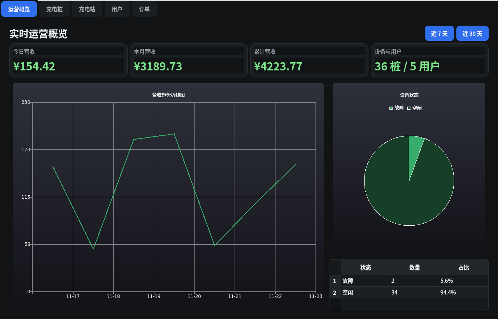
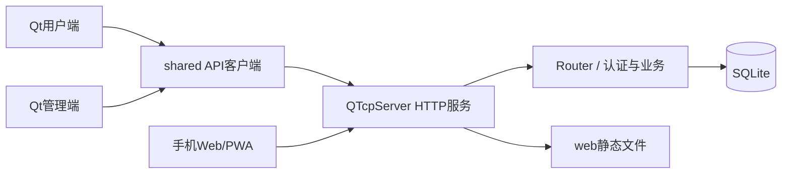

# 电动汽车充电桩应用管理平台

基于 **Qt 6 / C++17 / SQLite** 的课程工程，串联找桩、预约、模拟充电与结算，以及管理员设备和用户管理。桌面用户端、管理端和手机 Web 共用一套 HTTP/JSON 服务。

这是教学演示：充电、充值和设备重启均为模拟，不接实物充电桩、真实支付或短信认证。

## 效果与功能



| 入口 | 已实现功能 |
|---|---|
| Qt用户端 | 手机号登录、找桩与距离排序、地图导航、预约/取消、模拟充电、钱包及资料 |
| Qt管理端 | 运营概览、站点/电桩新增、设备状态及模拟重启、用户冻结/解冻、订单查看 |
| 手机Web/PWA | 登录、找桩、定位导航、预约充电、钱包和退出 |
| 服务端 | 业务接口、SQLite、内存会话、操作审计及静态资源 |

初始化生成6站点、36电桩和模拟历史订单。地图需要网络，无地址解析Key时采用模拟定位降级。当前版本不提供机器学习负荷预测。

## 架构与实现



- [shared/apiclient.cpp](shared/apiclient.cpp)：统一请求、认证头和JSON响应。
- [server/httpserver.cpp](server/httpserver.cpp)：按连接缓冲请求、处理半包与正文上限。
- [server/router.cpp](server/router.cpp)：预约、充电、钱包、管理接口和认证。
- [server/database.cpp](server/database.cpp)：建表、索引、模拟数据及访问。

```text
EVChargePlatform.pro     qmake总工程
server/                 HTTP、业务与SQLite
shared/                 公共网络和主题
user/  admin/           两个Qt桌面程序
web/                    手机页面和PWA资源
scripts/                构建、启停和集成测试
tests/                  API测试与源码守卫
docs/                   复现、技术档案和验证记录
```

## 环境与快速启动

目标：**Ubuntu22.04 x86_64、Qt6.2.4、GCC11、qmake6、SQLite3、Python3**。桌面需要图形会话；WSL2需可用WSLg。Windows原生Qt构建未作为本轮验收目标。

```bash
git clone https://github.com/dthu7b8a-design/ev-charge-platform.git
cd ev-charge-platform
bash setup_env.sh
bash scripts/build_qmake.sh
bash scripts/run_demo.sh
```

本整理通过[PR #1](https://github.com/dthu7b8a-design/ev-charge-platform/pull/1)交付；上述命令按main克隆。需要固定分支时可检出`cleanup/evcharge-audit-20261123`，当前合并状态以PR页面为准。

桌面默认连接本机8080，手机入口为 **`http://主机IP:8080/mobile/`**。演示手机号 `13800138001`；管理员 `admin / 123456`，仅用于隔离演示。

```bash
bash scripts/stop_demo.sh
```

不需要外部数据或模型；首次运行创建SQLite。已有数据库含用户余额和订单，不能当缓存删除。

## 测试与复现

```bash
bash scripts/test_all.sh
python3 tests/check_qt_ui_regressions.py
# 可选Node.js语法检查
node --check web/mobile/app.js
node --check web/mobile/sw.js
```

集成脚本使用独立数据，验证API、手机资源和SQLite；源码守卫不等于桌面交互测试。实际结果与未验收范围见 [验证记录](docs/VALIDATION.md)。

单独启动、隔离数据、目录覆盖、地图参数和排错见 [完整复现](docs/REPRODUCIBILITY.md)；依赖见 [环境说明](ENVIRONMENT.md)。

## 团队与个人贡献

第7组四人课程项目。李石屹担任组长，负责总体架构与集成，承担需求基线、qmake总工程、shared公共网络与主题层、服务端启动及HTTP通信层的复核完善，以及构建脚本、跨模块联调和交付版本核对。

魏明德主责用户端与手机体验，王耔樾主责管理端，李博文主责数据库和业务接口。以上依据团队分工与个人总结描述职责，不把整包导入提交解释为个人独立编写全部代码。

## 文档与限制

- [技术档案与面试准备](docs/PROJECT_TECHNICAL_GUIDE.md)
- [正式成果索引及公开边界](docs/ARTIFACTS.md)
- [整理与回滚报告](docs/PROJECT_CLEANUP_REPORT.md)

手机号无短信校验，管理员使用演示密码，token只存服务端内存；HTTP是教学子集，未有TLS、限流或生产压测证明。计量按功率和时间模拟，头像为本地路径，种子数据日期随初始化变化。设备协议、生产鉴权、正式迁移和真实计费可作为后续工程方向，不属于现有功能。
